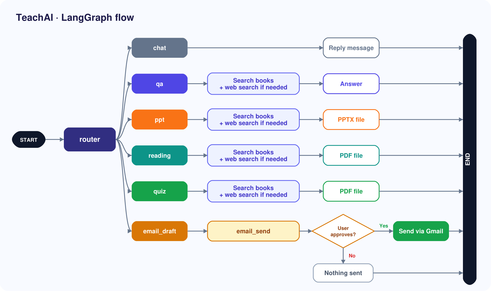

# TeachAI: Teaching Assistant Chatbot

A chatbot for teachers. Upload your books, then ask questions or ask it to make a **PPT**, **reading material**, a **quiz paper** and **emails to students**. Nothing is emailed until the teacher approves it.

Built with **LangGraph, LangChain, FastAPI, React** and a free **Groq** model.

## Features

- **Ask your books:** answers come from your uploaded PDFs (RAG), with page numbers. Web search is used only if the books don't cover the topic.
- **PPT:** colourful slides with AI images and speaker notes (`.pptx`).
- **Reading material:** styled PDF of reading material with headings, highlights, images. It follows the class PPT.
- **Quiz paper:** styled PDF with MCQ, short and long questions, plus an answer key page.
- **Email with approval:** the bot shows the draft, you click Approve, then it sends.
- **Chat history:** saved on your computer, so chats survive a restart.

## LangGraph flow



## Tech stack

| Part | Tools |
|---|---|
| Agent | LangGraph, LangChain, Pydantic |
| AI model | Groq (`openai/gpt-oss-120b`) |
| Book search | PyMuPDF, ChromaDB |
| Web and images | DuckDuckGo search, Pollinations |
| Files | python-pptx, ReportLab, Pillow |
| Backend | FastAPI, Uvicorn, SQLite |
| Frontend | React, Vite |
| Email | Gmail SMTP (App Password) |


## Setup

You need Python 3.10+, Node 18+, a free [Groq API key](https://console.groq.com) and (for email) a Gmail App Password.

```bash
# 1. Backend
cd backend
python3 -m venv .venv && source .venv/bin/activate
pip install -r requirements.txt
cp .env.example .env        # then add your keys
uvicorn app.main:app --reload --port 8000

# 2. Frontend (new terminal)
cd frontend
npm install
npm run dev                 # open http://localhost:5173
```

`.env` settings:

| Name | Meaning |
|---|---|
| `GROQ_API_KEY` | your Groq key |
| `SMTP_USER` / `SMTP_PASSWORD` | Gmail address and its **App Password** (not your real password) |
| `STUDENT_EMAILS` | default recipients (optional) |
| `EMAIL_WHITELIST` | only these addresses or domains may receive mail (optional) |

<!-- ## Try it

1. Upload a book PDF.
2. `Explain neural networks`
3. `Make a 6 slide ppt for class 7 on neural networks`
4. `Make reading material for class 7`
5. `Make a quiz of 8 questions for class 7`
6. `Email the reading material of class 7 to me@gmail.com` and click **Approve** -->

## Evaluation

Run from `backend/`:

```bash
python -m evaluation.run_router   # router accuracy
python -m evaluation.run_judge    # LLM-as-judge scores
```

| Test | Result |
|---|---|
| Router picks the right action (42 labelled messages) | **41/42 (98%)** |
| Output quality, scored 1-5 by a different model (8 outputs) | **4.06 / 5** |
| Plain checks (slide and question counts, approval before email) | **16/16 passed** |

The judge test is small, so treat the scores as a rough guide. Reports are in `backend/evaluation/results/`.

<!-- ## Safety

- Email is never sent without a click on **Approve**.
- Optional recipient whitelist.
- Secrets live in `.env`, which is not uploaded to git.

## Limits

- Scanned (image-only) PDFs can't be searched.
- No login. Use it on your own computer.
- Groq's free tier has rate limits, so long outputs can be slow.
- Generated images are decorative and may not suit technical topics. -->
# TeachAI
